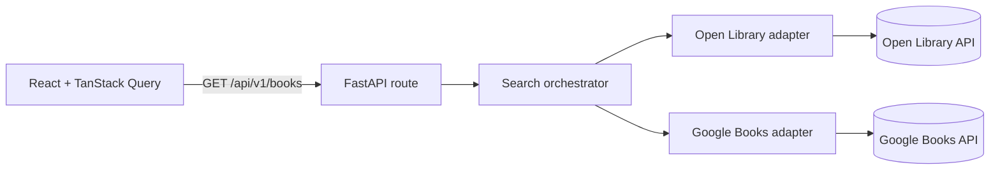
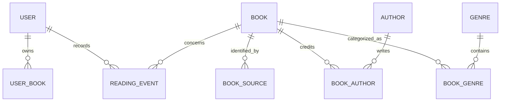

# Phase 1 architecture

The route validates public request parameters and maps total upstream failure to HTTP 502. The search service concurrently queries the configured provider adapters, isolates each error, deduplicates exact normalized title/author matches, and sorts results deterministically. Provider results have provider-specific pagination, so `fetched_count` is the number of unique results received for the requested provider pages and `total` is intentionally null. Results are not presented as a combined provider total.

The provider adapters map only fields supported by their source. Google Books previews are labeled as previews; an ordinary catalog record is not represented as downloadable. Open Library catalog records are distinct from reading availability, with a `read` link only when the search record reports a public scan. This signal is not a general rights determination. Project Gutenberg's catalog index is queried through Gutendex for search and its download-popular ranking; BookVerse uses only ebook URLs returned by the index and links to the Gutenberg source record. A `copyright=false` signal is represented as public domain in the United States, not worldwide. A URL existing in a catalog does not itself establish free access or redistribution rights.

Cross-provider duplicate matching currently requires an exact normalized title and ordered author list. Matching records contribute separate source entries to one result/detail view and one internal book record. This conservative title/author strategy can still collapse distinct editions; edition-aware matching by validated ISBN is a future improvement.

## Reliability

Public search cache keys include the normalized query, language, access type, page, limit, and selected providers; responses contain no user-specific data. Cache read/write failures degrade to a miss and are logged by exception class only. Upstream HTTP calls use explicit timeouts, retry 429/5xx and common connection failures once, and are concurrency-limited. API/auth requests use a process-local sliding window limiter. This is adequate for a single instance; horizontal deployments need a shared gateway or distributed rate limit. `/health` is a liveness check; `/ready` requires PostgreSQL and reports Redis as healthy or degraded because Redis is optional for request correctness.

The ERD shows the planned normalized data model; persistence and migrations are not part of Phase 1.

## Recommendations

Recommendations compare normalized title/description tokens, exact authors, genres, and language. The deterministic score uses a normalized weighted average (genre 0.45, author 0.30, text 0.20, language 0.05 over features present on both books). Reasons are returned only for actual overlaps. Personal recommendations use only the requesting user's `reading`/`finished`/rated books as seeds and exclude every book already in that user's library. Results below 0.10 similarity are suppressed. Similar-book results exclude the requested book. This is a transparent baseline: provider genre coverage and author names vary, editions are not yet unified, and no collaborative or popularity signal is included.
