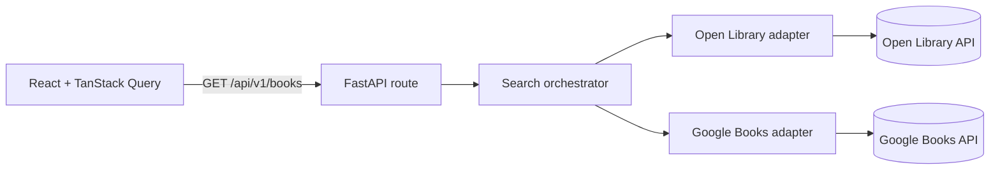
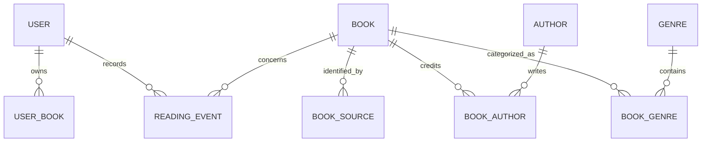

# Phase 1 architecture

The route validates public request parameters and maps total upstream failure to HTTP 502. The search service concurrently queries the configured provider adapters, isolates each error, deduplicates exact normalized title/author matches, and sorts results deterministically. Provider results have provider-specific pagination, so `fetched_count` is the number of unique results received for the requested provider pages and `total` is intentionally null. Results are not presented as a combined provider total.

The provider adapters map only fields supported by their source. Google Books previews are labeled as previews; an ordinary catalog record is not represented as downloadable. Open Library catalog records are distinct from reading availability, with a `read` link only when the search record reports a public scan. This signal is not a general rights determination. Cross-source duplicate matching currently requires an exact normalized title and ordered author list; it is deliberately conservative but can still collapse same-title editions in the result view. Persistent edition-aware matching is deferred until the database phase.

The ERD shows the planned normalized data model; persistence and migrations are not part of Phase 1.
